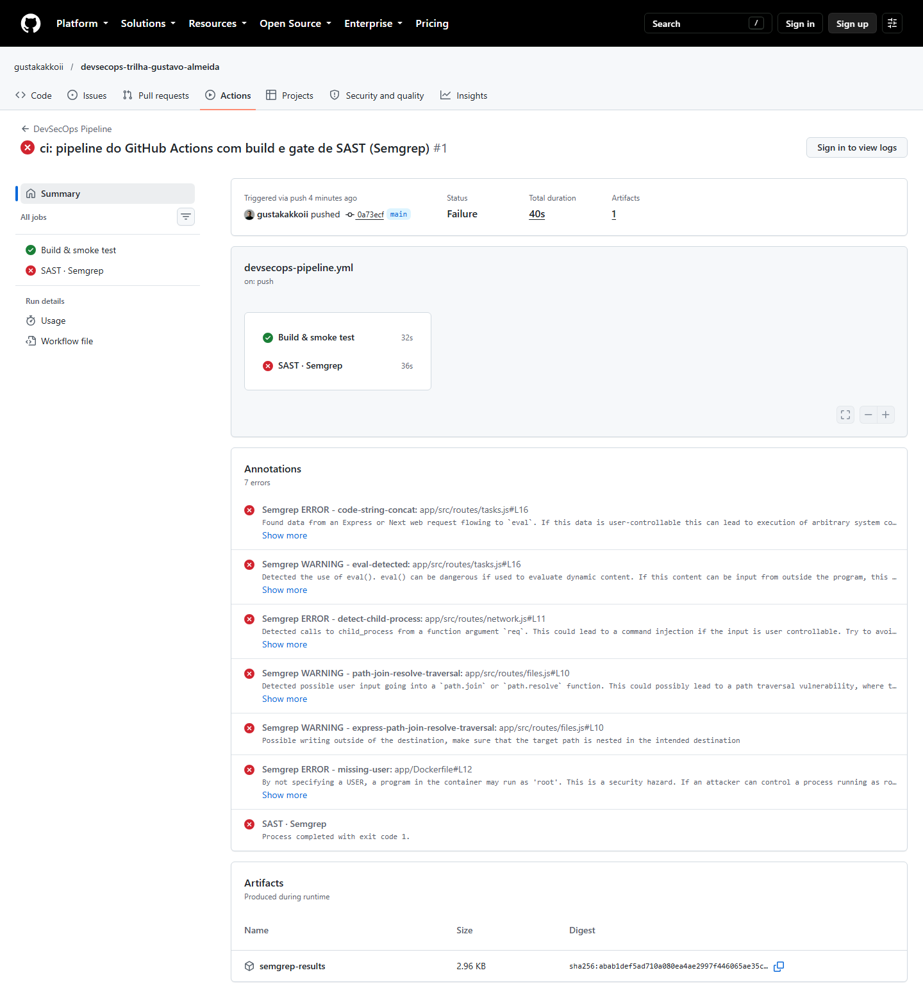
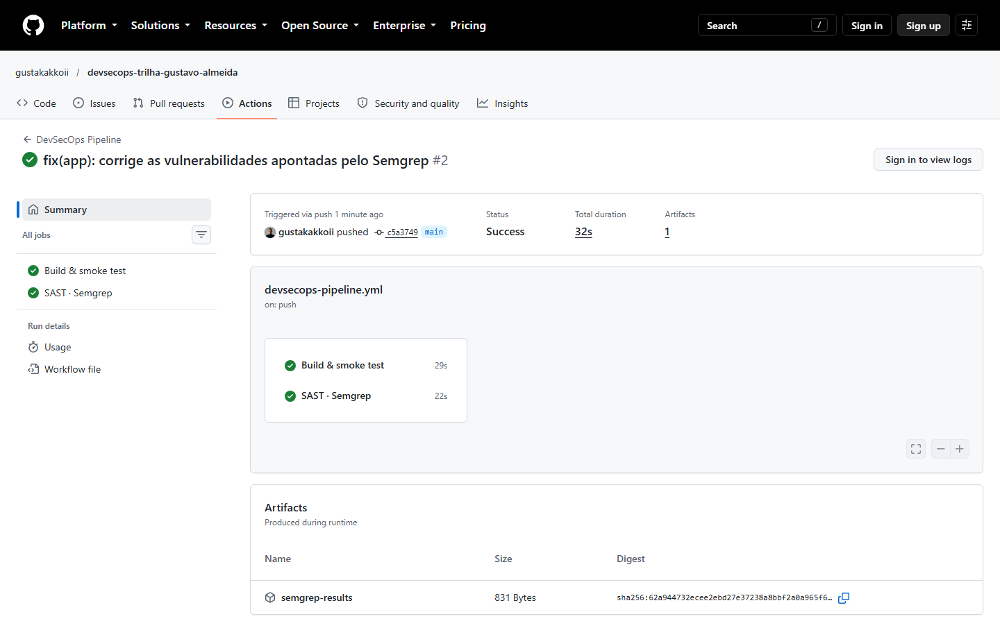
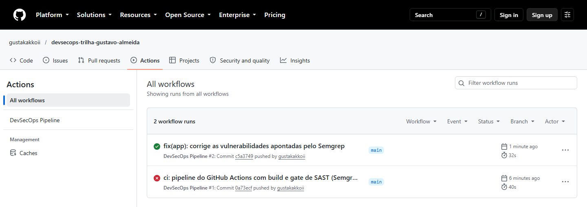

# Bloco 2 — Pipeline segura & Análise estática (SAST)

> **Entregas deste bloco**
> - Workflow: [`devsecops-pipeline.yml`](devsecops-pipeline.yml) (cópia do arquivo ativo em [`.github/workflows/`](../.github/workflows/devsecops-pipeline.yml), na versão do Bloco 2)
> - Print da pipeline **falhando** com os achados do Semgrep: [`prints/01-pipeline-falhando-semgrep.png`](prints/01-pipeline-falhando-semgrep.png)
> - Print da pipeline **passando** depois da correção: [`prints/02-pipeline-passando.png`](prints/02-pipeline-passando.png)
> - Histórico vermelho → verde: [`prints/03-historico-vermelho-verde.png`](prints/03-historico-vermelho-verde.png)
> - Execuções no GitHub: [#1 (falhou)](https://github.com/gustakakkoii/devsecops-trilha-gustavo-almeida/actions/runs/38328652896) · [#2 (passou)](https://github.com/gustakakkoii/devsecops-trilha-gustavo-almeida/actions/runs/38329088235)

## 1. O que foi construído

Uma pipeline de CI no **GitHub Actions** que roda sozinha a cada `push` e `pull request` na `main`, com dois jobs em paralelo:

```
             push / pull request na main
                         │
          ┌──────────────┴──────────────┐
          ▼                             ▼
 ┌──────────────────┐         ┌───────────────────┐
 │ Build & smoke    │         │ SAST · Semgrep    │
 │ test             │         │ (GATE)            │
 │ npm ci           │         │ achado ERROR ou   │
 │ docker build     │         │ WARNING → exit 1  │
 │ GET /health      │         │ → job FALHA       │
 └──────────────────┘         └───────────────────┘
          │                             │
          └──────────────┬──────────────┘
                         ▼
          check verde ✅ ou vermelho ❌ no commit/PR
```

O ciclo pedido pela missão foi cumprido em três commits:

| # | Commit | Resultado da pipeline |
| :--- | :--- | :--- |
| 1 | `ci: pipeline do GitHub Actions com build e gate de SAST (Semgrep)` | ❌ **Falhou.** Build ok, Semgrep encontrou **6 achados** (3 ERROR, 3 WARNING) |
| 2 | `fix(app): corrige as vulnerabilidades apontadas pelo Semgrep` | ✅ **Passou.** 0 achados bloqueantes |
| 3 | `docs(bloco2): ...` (esta entrega) | ✅ |

## 2. O workflow, parte por parte

### Gatilhos (`on:`)
```yaml
on:
  push:          { branches: [main] }   # todo push na main
  pull_request:  { branches: [main] }   # todo PR que mira a main (é aqui que o gate impede o merge)
  workflow_dispatch:                    # botão "Run workflow" para rodar manualmente (útil na demo ao vivo)
```
Usei `pull_request` e **não** `pull_request_target`: no `pull_request`, um PR vindo de fork roda com token somente leitura e sem acesso aos secrets, então código de terceiros não consegue roubar nada.

### Segurança da própria pipeline
A pipeline também é superfície de ataque (ela roda código e tem acesso a token e secrets), então ela também foi endurecida:

| Configuração | Por quê |
| :--- | :--- |
| `permissions: contents: read` | **Menor privilégio.** O `GITHUB_TOKEN` automático só consegue ler o repositório. Se algum passo for comprometido, ele não consegue dar push, criar release etc. |
| Actions fixadas por **SHA de commit** (`actions/checkout@3d3c42e...  # v7.0.1`) | Uma *tag* (`v7`) pode ser movida para outro commit pelo dono do repositório, ou por um atacante que roube a conta dele. O SHA é imutável. Caso real: em **março de 2026** atacantes moveram 76 das 77 tags do `aquasecurity/trivy-action` para um código que roubava os secrets dos pipelines; quem fixava por SHA não foi afetado. (O mesmo aconteceu com `tj-actions/changed-files` em 2025.) |
| `persist-credentials: false` no checkout | Por padrão o checkout deixa o token salvo em `.git/config`. Desligando, os passos seguintes (ferramentas de terceiros) não têm acesso a ele. |
| Versão do Semgrep fixa (`semgrep==1.179.0`) e runner fixo (`ubuntu-24.04` em vez de `ubuntu-latest`) | **Reprodutibilidade:** o mesmo commit dá o mesmo resultado amanhã. Atualizar a versão vira uma mudança consciente (via PR), não uma surpresa. |
| `timeout-minutes` | Um passo travado não fica consumindo minutos de CI indefinidamente. |
| `concurrency` | Push novo num PR cancela a execução antiga daquele PR (economia). Na `main` nada é cancelado. |
| `defaults: run: shell: bash` | Com `shell: bash` explícito o GitHub roda `bash -eo pipefail`: qualquer comando que falhar, inclusive no meio de um pipe (`a \| b`), falha o passo. Assim um erro não passa despercebido. |

### Job 1 — `Build & smoke test` (etapa de build/instalação de dependências)
1. **`npm ci --omit=dev`**: instala **exatamente** as versões do `package-lock.json` e **falha** se o lockfile estiver dessincronizado do `package.json`. O `npm install` poderia atualizar versões silenciosamente. `--omit=dev` = só dependências de produção.
2. **`docker build`**: constrói a imagem a partir do `Dockerfile` do app, garantindo que o artefato que vai para produção builda.
3. **Smoke test**: sobe o container e chama `GET /health` até 20 vezes (1 s de intervalo). Se não responder, o job falha e mostra os logs do container. É um teste rápido de "a aplicação pelo menos sobe?".

### Job 2 — `SAST · Semgrep` (o gate)
```bash
semgrep scan --config p/default --severity ERROR --severity WARNING \
  --error --metrics off --json-output semgrep-results.json .
```

| Flag | Função |
| :--- | :--- |
| `--config p/default` | Ruleset padrão curado pela Semgrep (JavaScript, Dockerfile, YAML do Actions...) |
| `--severity ERROR --severity WARNING` | Só contam achados de severidade alta e média |
| `--error` | **Exit code 1 se houver achado. É isso que transforma o scan em gate.** |
| `--metrics off` | Não envia telemetria |
| `--json-output semgrep-results.json` | Salva uma cópia dos resultados em JSON (usada para anotações e artefato) |
| `.` | Analisa o repositório inteiro: app, Dockerfile e o próprio workflow |
Depois do scan, dois passos com `if: !cancelled()` (rodam **mesmo que o gate tenha falhado**):
- **Anotações**: um `jq` transforma cada achado do JSON numa linha `::error file=...,line=...::mensagem`. O GitHub mostra isso no resumo da execução e **na linha exata do código** no commit/PR (é o que aparece no print 01).
- **Artefato**: o JSON completo fica salvo por 30 dias para auditoria.

## 3. Como o gate funciona (e como ele impede o merge)

1. O Semgrep encontra um achado ERROR/WARNING → por causa do `--error`, termina com **exit code 1**.
2. No GitHub Actions, qualquer comando com exit code ≠ 0 **falha o passo** → falha o **job** → o commit recebe um **check vermelho ❌**.
3. Para o check vermelho virar **bloqueio de merge**, a branch `main` precisa de uma regra de proteção que **exija esse check**:
   *Settings → Rules → Rulesets → New branch ruleset* → alvo: `main` → marcar **Require status checks to pass** → adicionar os checks `Build & smoke test` e `SAST · Semgrep`.
   Com isso o botão **Merge** de qualquer PR fica desabilitado enquanto o check estiver vermelho.

**Política de severidade escolhida:** ERROR (alta) e WARNING (média) bloqueiam; INFO não bloqueia.
- Bloquear tudo, inclusive INFO, gera muito ruído e o time passa a ignorar ou desligar o gate.
- Bloquear só ERROR deixaria passar o path traversal (que a regra classifica como WARNING) e que, como mostrei na prova de conceito abaixo, vazava as credenciais do servidor.
- Exemplo de INFO que ficou de fora: `express-check-csurf-middleware-usage` (sugere proteção contra CSRF). Não se aplica aqui: a API é JSON e não usa cookie de sessão, que é o que o CSRF explora.

**Fail-closed:** se o Semgrep não conseguir rodar (erro de rede ao baixar as regras, por exemplo), ele sai com código 2 e o job **também falha**. Na dúvida, a pipeline bloqueia em vez de deixar passar.

## 4. Como o Semgrep "pensa" (importante para a defesa)

- **Regras em YAML** descrevem padrões de código. O Semgrep **não procura texto** como um `grep`: ele faz o *parse* do código numa árvore sintática (AST) e compara estruturas. Por isso `eval(x)` é encontrado independentemente de espaços, quebras de linha ou nome da variável.
- **Taint mode (análise de fluxo de dados)**, usado nas regras de injeção e path traversal:
  - **source** (fonte): de onde vem o dado não confiável → `req.query`, `req.params`, `req.body`;
  - **sink** (destino perigoso): `eval()`, `child_process.exec()`, `path.join()/path.resolve()`;
  - **sanitizer**: função que "limpa" o dado no caminho.
  O alerta só acontece se o dado sai da *source* e chega no *sink* **sem passar por um sanitizer**.
- **Caso real da trilha:** a primeira correção do `files.js` usou só `path.basename(...)`, e o Semgrep **continuou acusando**. Fui ler a definição da regra e vi que ela só reconhece como sanitizer `.replace()`, `.indexOf()` ou uma função cujo nome contém `sanitize`. Criei então `sanitizeFilename()`, que faz uma limpeza de verdade (basename + allowlist de caracteres) e que a regra reconhece. **Isso não é "enganar a ferramenta":** a validação é real (testada com ataques abaixo) e ainda tem uma segunda barreira (verificar que o caminho final fica dentro de `uploads/`).
- **Limitações:** o Semgrep Community Edition analisa o fluxo **dentro de um mesmo arquivo**, e a análise entre arquivos é recurso da versão paga. Ele também não entende regra de negócio (ver o mass assignment abaixo, que ele não pegou).

## 5. Achados, impacto comprovado e correções

Antes de corrigir, confirmei na imagem original que **cada achado era explorável de verdade** (prova de conceito local, no meu próprio container):

| Regra do Semgrep (severidade) | Vulnerabilidade | Prova de conceito na versão original | Correção |
| :--- | :--- | :--- | :--- |
| `code-string-concat` (ERROR) + `eval-detected` (WARNING) — `tasks.js:16` | **Eval injection → execução remota de código** (CWE-95) | `GET /api/tasks/filter?expr=process.exit(0)` **derrubou o servidor**; qualquer JS poderia ser executado | Removido o `eval`. O filtro agora aceita só `done`, `owner` e `q` e compara valores. Nenhum texto do usuário é executado. |
| `detect-child-process` (ERROR) — `network.js:11` | **Injeção de comando no SO** (CWE-78) | `GET /api/ping?host=127.0.0.1;id` devolveu `uid=0(root)`, ou seja, comando arbitrário **como root** | Removida a chamada ao shell. O diagnóstico usa a API nativa de DNS do Node (`dns.lookup`), e o `host` é validado (IP ou nome de domínio RFC 1123). Sem processo externo, não existe o que injetar. |
| `path-join-resolve-traversal` + `express-path-join-resolve-traversal` (WARNING) — `files.js:10` | **Path traversal** (CWE-22) | `GET /api/files/..%2Fsrc%2Fconfig.js` **devolveu o `config.js` com o JWT secret e as chaves AWS** | `sanitizeFilename()` (basename + allowlist, sem arquivos ocultos) + verificação de que o caminho resolvido continua em `uploads/` |
| `missing-user` (ERROR) — `Dockerfile:12` | **Container rodando como root** (CWE-250) | `docker exec ... id` → `root` | `USER node`: o processo roda com o usuário sem privilégios que já existe na imagem oficial do Node |
| *(não detectado pelo Semgrep)* — `tasks.js` PATCH | **Mass assignment** (CWE-915) | `PATCH /api/tasks/3 {"id":999}` trocava o id da tarefa | O PATCH aceita só `title`, `done` e `owner`. **Exemplo de falso negativo do SAST**, encontrado na revisão manual. |

Por que corrigir a **causa** e não só "esconder" o alerta: para o `exec`, uma correção comum seria trocar por `execFile` com validação. Preferi **eliminar o processo externo**, porque sem shell não existe injeção de comando possível. Além disso, no Bloco 3 a imagem passa a ser mínima e nem teria o binário `ping`.

## 6. Validação da correção

Testes feitos no container corrigido (mesma imagem que a pipeline builda):

| Requisição | Antes | Depois |
| :--- | :--- | :--- |
| `/api/tasks/filter?done=true` | — (não existia) | `200`, tarefas concluídas |
| `/api/tasks/filter?expr=process.exit(0)` | servidor **caiu** | `400` (parâmetro não aceito) |
| `/api/ping?host=localhost` | `200` | `200`, endereços resolvidos |
| `/api/ping?host=8.8.8.8;id` | executava `id` como root | `400` (host inválido) |
| `/api/files/bem-vindo.txt` | `200` | `200` |
| `/api/files/..%2Fsrc%2Fconfig.js` | **vazava credenciais** | `404` (confinado a `uploads/`) |
| `/api/files/.env` | lia o arquivo, se existisse | `400` (arquivo oculto bloqueado) |
| `PATCH /api/tasks/3 {"id":999}` | trocava o id | id preservado |
| usuário do processo no container | `root` | `node` |

E a pipeline voltou a passar: execução **#2 verde**.

## 7. Evidências

**Pipeline falhando**: build ✅, Semgrep ❌ com as 6 anotações (arquivo e linha de cada achado) e "Process completed with exit code 1":



**Pipeline passando** depois da correção:



**Histórico**: #1 vermelho → #2 verde:



## 8. Perguntas prováveis na defesa

**Por que o Semgrep e não outra ferramenta de SAST?**
É open source, roda localmente e no CI com um comando, tem um registry grande de regras prontas (inclusive para Dockerfile e para o YAML do GitHub Actions), as regras são legíveis (YAML) e dá para criar regras próprias. Ele é rápido (segundos), o que importa para não atrasar o feedback.

**O que exatamente faz o job falhar?**
A flag `--error`: com achados, o Semgrep termina com exit code 1. O Actions considera qualquer exit code diferente de 0 como falha do passo e, portanto, do job.

**Por que ERROR e WARNING, e não só ERROR?**
Porque a classificação de severidade da regra não é perfeita: o path traversal veio como WARNING e permitia ler as credenciais do servidor. Bloquear também os INFO geraria ruído demais. ERROR+WARNING é o equilíbrio entre segurança e ruído.

**E se for um falso positivo?**
Analiso. Se confirmar que é falso positivo, suprimo **só aquela linha** com um comentário `// nosemgrep: <id-da-regra>` **e a justificativa**. Isso fica versionado e revisável no PR. Nunca desligo a regra inteira nem tiro a flag `--error`.

**Por que fixar as actions por SHA?**
Tag é um ponteiro mutável, SHA não. Em março de 2026 as tags do `trivy-action` foram reescritas para um código malicioso que roubava secrets de pipelines. Quem usava `@v0.x` executou o malware, e quem usava o SHA não.

**O que o `permissions: contents: read` protege?**
Limita o que o `GITHUB_TOKEN` pode fazer. Mesmo que um passo da pipeline seja comprometido, o token não serve para alterar o repositório.

**Por que `npm ci` e não `npm install`?**
`npm ci` é determinístico: instala exatamente o lockfile e falha se ele estiver inconsistente. É o comando feito para CI.

**Por que a correção do `files.js` tem duas barreiras?**
Defesa em profundidade: se um dia alguém mudar a `sanitizeFilename` e introduzir um erro, a verificação de prefixo (`startsWith(UPLOADS_DIR + path.sep)`) ainda impede sair de `uploads/`.

**O SAST pega tudo?**
Não. O mass assignment do PATCH não foi detectado, um falso negativo. Por isso SAST é uma camada e não a única: no Bloco 3 entram SCA, scan de container e de segredos, e revisão de código continua importante.

**Os jobs rodam em paralelo. Isso é problema?**
Não: são independentes, e o paralelismo deixa o feedback mais rápido. O que importa é que **todos** precisam passar para o check final ficar verde. No Bloco 3 o deploy depende (`needs:`) de todos os gates.
