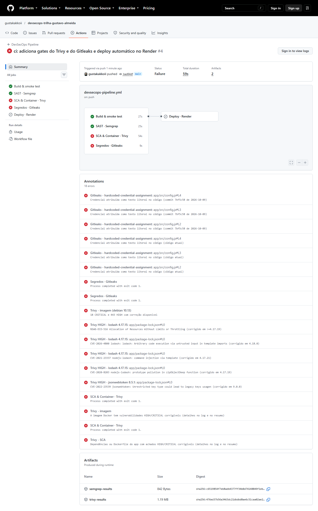
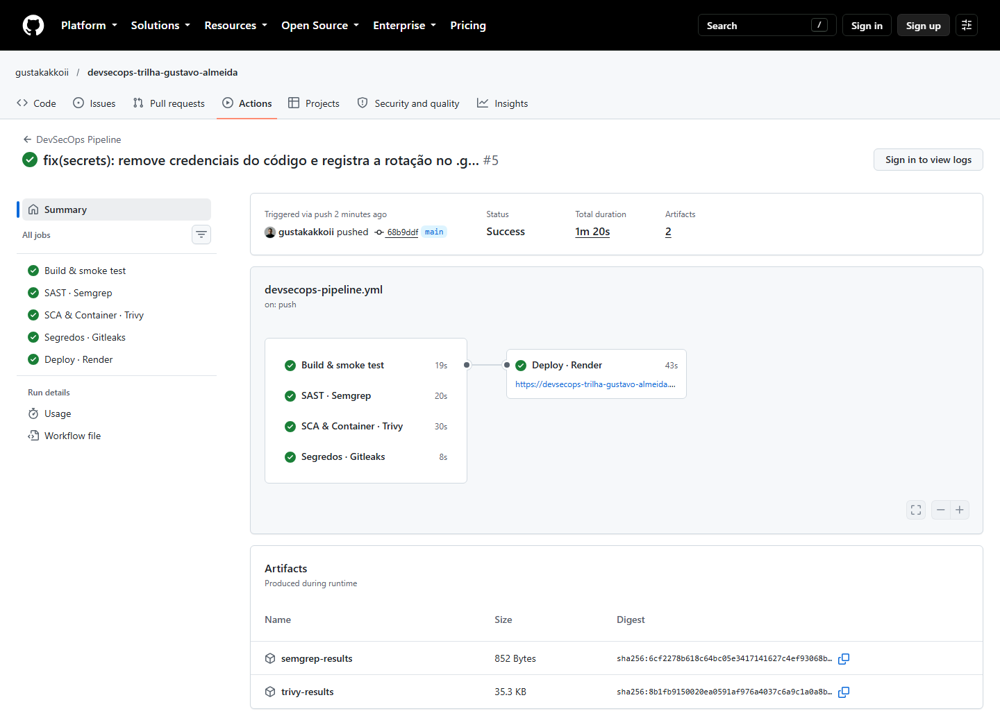
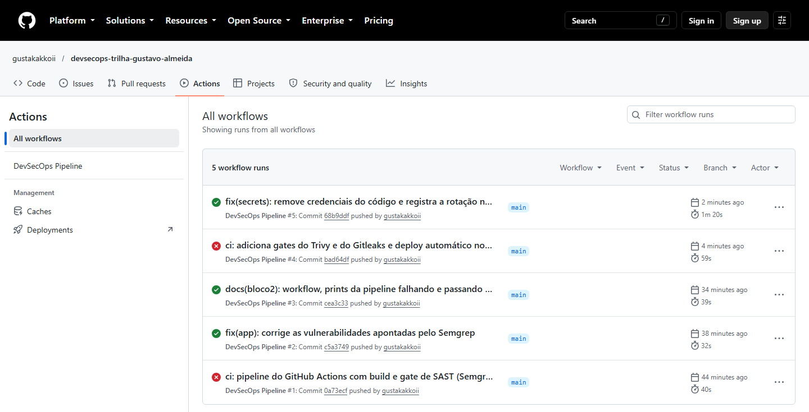
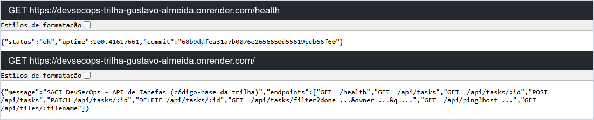

# Bloco 3 — Containers, dependências, segredos & deploy automatizado

> **Entregas deste bloco**
> - Workflow atualizado (3 gates de segurança + deploy): [`devsecops-pipeline.yml`](devsecops-pipeline.yml) (cópia do arquivo ativo em [`.github/workflows/`](../.github/workflows/devsecops-pipeline.yml))
> - Relatório de viabilidade (1 página): [`relatorio-viabilidade.pdf`](relatorio-viabilidade.pdf)
> - Link da aplicação no Render: **https://devsecops-trilha-gustavo-almeida.onrender.com** ([`link-aplicacao.md`](link-aplicacao.md))
> - Prints: [pipeline falhando nos novos gates](prints/01-pipeline-falhando-trivy-gitleaks.png) · [pipeline completa com sucesso](prints/02-pipeline-completa-sucesso.png) · [histórico](prints/03-historico-execucoes.png) · [aplicação no ar](prints/04-aplicacao-no-render.png)
> - Execuções no GitHub: [#4 (gates novos falharam, deploy pulado)](https://github.com/gustakakkoii/devsecops-trilha-gustavo-almeida/actions/runs/38331855030) · [#5 (tudo verde + deploy)](https://github.com/gustakakkoii/devsecops-trilha-gustavo-almeida/actions/runs/38332022635)

## 1. A pipeline completa

```
                      push / pull request na main
                                  │
     ┌──────────────┬─────────────┼──────────────┬──────────────────┐
     ▼              ▼             ▼              ▼                  │
 ┌────────┐   ┌──────────┐  ┌────────────┐  ┌────────────┐          │
 │ Build  │   │ Semgrep  │  │   Trivy    │  │  Gitleaks  │  ← jobs em paralelo;
 │ npm ci │   │  (SAST)  │  │ SCA + misc │  │  código +  │    cada gate falha o
 │ docker │   │          │  │ + imagem   │  │  histórico │    próprio job
 └───┬────┘   └────┬─────┘  └─────┬──────┘  └─────┬──────┘
     └─────────────┴──────┬───────┴───────────────┘
                          ▼   needs: [todos]  +  só na main
                 ┌──────────────────┐
                 │  Deploy · Render │  dispara o Deploy Hook com ref=<SHA>
                 │                  │  e espera /health responder com esse SHA
                 └────────┬─────────┘
                          ▼
     https://devsecops-trilha-gustavo-almeida.onrender.com
```

Ciclo deste bloco (commits na `main`):

| Commit | O que fez | Pipeline |
| :--- | :--- | :--- |
| `bad64df` `ci: adiciona gates do Trivy e do Gitleaks e deploy automático no Render` | Evolui o workflow, cria `.gitleaks.toml` e faz o `/health` informar o commit | ❌ **#4** Trivy e Gitleaks falharam, **deploy pulado** (nada foi para produção) |
| `dcdaccf` `fix(deps): ...` | `lodash` 4.17.15 → 4.18.1, `jsonwebtoken` 8.5.1 → 9.0.3 | (mesmo push) |
| `aea8f90` `fix(docker): ...` | `node:14` → build multi-stage + `distroless/nodejs24-debian13:nonroot` | (mesmo push) |
| `68b9ddf` `fix(secrets): ...` | Credenciais fora do código, rotação do JWT secret, `.gitleaksignore` | ✅ **#5** todos os gates verdes + **deploy no Render** |

As três correções foram enviadas num único `push`: o GitHub roda **uma** execução para o último commit do push, que já contém tudo.

---

## 2. Trivy: SCA + scan de container (+ misconfiguração)

### O que ele verifica
O Trivy roda **três análises** no job `SCA & Container · Trivy`:

| Análise | Comando | O que olha |
| :--- | :--- | :--- |
| **SCA** (dependências) | `trivy fs --scanners vuln` em `app/` | Lê o `package-lock.json` e compara cada pacote e versão com a base de vulnerabilidades |
| **Misconfiguração** (IaC) | `trivy fs --scanners misconfig` em `app/` | Más práticas no `Dockerfile` (ex.: rodar como root, sem `USER`) |
| **Container** | `trivy image` na imagem buildada no job | Pacotes do **sistema operacional** da imagem base (Debian, Alpine...) **e** bibliotecas que foram parar dentro dela (inclusive o npm e as dependências dele) |

**De onde vêm os dados:** o Trivy baixa a *trivy-db*, que junta várias fontes públicas: NVD, GitHub Security Advisories, os trackers de segurança das distribuições (Debian, Alpine, Ubuntu...) etc. Ele **não executa** nada: identifica o que está instalado e cruza nome + versão com a base. Para pacotes do SO ele usa o próprio tracker da distribuição, que informa se já existe versão corrigida.

### Como o gate foi configurado (e por quê)
```bash
trivy fs    --scanners vuln,misconfig --severity HIGH,CRITICAL --ignore-unfixed --exit-code 1 app/
trivy image --scanners vuln           --severity HIGH,CRITICAL --ignore-unfixed --exit-code 1 task-api:<sha>
```
| Opção | Decisão |
| :--- | :--- |
| `--exit-code 1` | É o que transforma o scan em **gate**: achou algo no critério → job falha. |
| `--severity HIGH,CRITICAL` | A missão fala em "achado crítico", mas as dependências vulneráveis do app eram **HIGH** (ex.: CVE-2021-23337, injeção de comando no `lodash`). Bloquear só CRITICAL deixaria passar todas elas. MEDIUM/LOW não bloqueiam, mas aparecem no relatório. |
| `--ignore-unfixed` | Só bloqueia CVE que **já tem versão corrigida**, ou seja, quando existe uma ação possível (atualizar). Uma CVE sem correção travaria todos os deploys sem ninguém poder resolver. Ela **não some**: o passo de relatório roda o Trivy de novo **sem esse filtro** e mostra tudo no resumo. Hoje a imagem tem 0 HIGH/CRITICAL **mesmo contando as sem correção**. |

**Gate decide, relatório informa:** o último passo (`if: !cancelled()`, roda mesmo após falha) gera JSON com **todas** as severidades, uma tabela no resumo da execução, anotações apontando o `package-lock.json` e os relatórios como artefato.

### Instalação segura da ferramenta (supply chain)
Em **março de 2026** o ecossistema do Trivy sofreu um ataque de supply chain: credenciais roubadas foram usadas para publicar um binário malicioso (v0.69.4) e reescrever as tags do `aquasecurity/trivy-action` para um código que **roubava os secrets das pipelines** de quem usava a action por tag. Por isso:
- **não uso a action**: baixo o binário oficial numa versão fixa (`0.75.0`);
- confiro o **SHA-256** contra um hash fixado no workflow (`sha256sum --check --strict`). Se o arquivo do release for trocado, o hash não bate e o job para antes de executar qualquer coisa.

### O que foi encontrado e como foi corrigido

| Alvo | Antes | Correção | Depois |
| :--- | :--- | :--- | :--- |
| `package-lock.json` | **5 HIGH**: `lodash 4.17.15` (CVE-2020-8203 prototype pollution, CVE-2021-23337 injeção via template, CVE-2026-4800 execução de código via template, NSWG-ECO-516) e `jsonwebtoken 8.5.1` (CVE-2022-23539) | `lodash 4.18.1`, `jsonwebtoken 9.0.3` (que puxou `jws 4`, `jwa 2`, `semver 7`) | **0** vulnerabilidades |
| Imagem (SO) | `node:14` = **Debian 10 sem suporte**: **21 CRITICAL, 545 HIGH** (ex.: CVE-2024-32002 no git, CVE-2023-38408 no openssh, vários no python2.7 e no kernel headers) | Base **distroless** Debian 13 | **0 CRITICAL, 0 HIGH** (23 MEDIUM, 8 LOW) |
| Imagem (Node) | **2 CRITICAL, 32 HIGH** (npm embutido + deps instaladas pelo npm 6, que nem lê lockfile v3) | Sem npm na imagem final; deps instaladas com `npm ci` do Node 24 | **0** |
| Dockerfile | — | `USER nonroot` explícito | 1 LOW (falta `HEALTHCHECK`; o Render já faz health check por HTTP e a distroless não tem shell para um `HEALTHCHECK CMD`) |

**O novo Dockerfile (multi-stage + distroless):**
1. **Estágio `deps`** (`node:24-trixie-slim`): `npm ci --omit=dev` instala só as dependências de produção, exatamente as do lockfile.
2. **Estágio final** (`gcr.io/distroless/nodejs24-debian13:nonroot`): copia só `node_modules`, `src/` e `uploads/`. A imagem **distroless** tem apenas o runtime do Node e as bibliotecas mínimas: **não tem shell, nem npm, nem gerenciador de pacotes**. Testei: `docker exec ... sh` retorna *"executable file not found"*. Se um atacante conseguir executar código, não tem shell nem ferramentas à mão.
3. Resultado: **1,37 GB → 226 MB**, root → `nonroot` (uid 65532), **≈600 → 0** CVEs HIGH/CRITICAL.

> **Sobre "alcançabilidade":** o app só usa `_.uniq` do lodash, não o `_.template`, que é onde estão as CVEs de injeção. O SCA não sabe disso: ele olha versão, não uso. Mesmo assim atualizar é o certo, porque é barato, evita que alguém passe a usar a função vulnerável no futuro e mantém o gate limpo, sem exceções para justificar.

---

## 3. Gitleaks: detecção de segredos (código + histórico)

### O que ele verifica
O Gitleaks procura credenciais (chaves de nuvem, tokens, chaves privadas, senhas) usando **regras** com expressão regular, palavras-chave (filtro rápido), **entropia** (o quão "aleatório" é o texto) e *allowlists* para evitar falsos positivos. O job roda **duas varreduras**:

| Passo | Comando | Para quê |
| :--- | :--- | :--- |
| Código atual | `gitleaks dir .` | Todos os arquivos como estão agora |
| **Histórico completo** | `gitleaks git .` | O *patch* de **cada commit** desde o primeiro. Um segredo que foi commitado e apagado depois **continua no histórico** e é encontrado aqui. |

- `fetch-depth: 0` no checkout: por padrão o Actions baixa **só o último commit**; sem isso a varredura do histórico não veria nada.
- `--redact`: o log de um repositório público é público, então o Gitleaks mostra o achado **sem o valor do segredo**. Não faz sentido vazar de novo o que estamos tentando proteger.
- Gate: qualquer achado → exit code 1 → job falha.

### Por que precisei de uma regra própria (`.gitleaks.toml`)
Rodando o Gitleaks com as regras padrão no código-base, ele **não encontrou nada**, embora o `config.js` tivesse três credenciais:
- a chave AWS do código é exatamente a **chave de exemplo da documentação da AWS**. O Gitleaks a ignora de propósito (allowlist), porque ela não dá acesso a nada;
- o JWT secret é uma **frase legível**, e as regras genéricas exigem texto de alta entropia (aleatório) justamente para não gerar falso positivo em qualquer string.

Como o objetivo do gate é barrar **qualquer credencial em texto puro no código**, criei uma regra que **estende** as padrão (`[extend] useDefault = true`, então nenhuma regra original é perdida):

```toml
[[rules]]
id = "hardcoded-credential-assignment"
regex = '''(?i)\b[a-z0-9_]*(?:secret|passw(?:or)?d|token|api_?key|access_?key(?:_?id)?|private_?key)[a-z0-9_]*["']?\s*[:=]\s*["']([^"'\s]{12,})["']'''
secretGroup = 1
```
Em português: *uma variável ou propriedade cujo nome indica credencial, recebendo um texto literal entre aspas com 12 ou mais caracteres*. `JWT_SECRET: process.env.JWT_SECRET` **não** casa, porque não é texto entre aspas. Por isso a correção (ler do ambiente) faz o achado sumir do código atual.

### Remover, rotacionar e registrar
Na execução #4 o Gitleaks achou as 3 credenciais **duas vezes**: no código atual (`config.js`, linhas 2–4) e no histórico (commit `7bf5c58`, que adicionou o código-base). A correção teve três partes:

1. **Remover do código:** `config.js` agora lê `JWT_SECRET` de variável de ambiente. As chaves AWS foram apagadas porque o app nem usa AWS. Há um `.env.example` com os nomes das variáveis, sem valores, e o `.env` está no `.gitignore`.
2. **Rotacionar:** um segredo que já esteve no Git deve ser considerado **vazado**. O JWT secret ganhou um **valor novo, gerado no Render** (Environment Variables, que funcionam como *secret manager*), que nunca passou pelo Git. Se as chaves AWS fossem reais, o primeiro passo seria **revogá-las no IAM**.
3. **Registrar a exceção do histórico** no `.gitleaksignore` (formato `commit:arquivo:regra:linha`), com um comentário explicando o motivo. O histórico continua contendo o valor antigo, mas ele **não vale mais nada**.

**Por que não reescrever o histórico** (`git filter-repo`/BFG)? Exige *force-push*, quebra os clones de todo mundo e **não apaga** cópias já feitas (clones, forks, caches). A rotação é obrigatória de qualquer jeito, e é ela que resolve o problema de verdade.

---

## 4. Deploy automático no Render

### Configuração do serviço
| Campo | Valor | Por quê |
| :--- | :--- | :--- |
| Tipo | Web Service, **Free** | Plano sem cartão de crédito |
| Fonte | Repositório GitHub, branch `main` | |
| Language | **Docker** | O Render builda a imagem a partir do `Dockerfile` do projeto |
| Root Directory | `app` | Onde estão o `Dockerfile` e o código |
| Health Check Path | `/health` | O Render só considera o deploy pronto (e troca a versão) quando `/health` responde 200 |
| **Auto-Deploy** | **Off** | Quem dispara o deploy é a pipeline, depois dos gates (ver abaixo) |
| Environment | `JWT_SECRET` (gerado pelo Render) | Secret manager: o segredo fica fora do código |

### Como o deploy só acontece depois de todos os gates
```yaml
deploy:
  needs: [build, sast-semgrep, sca-trivy, secrets-gitleaks]
  if: ${{ github.ref == 'refs/heads/main' && github.event_name != 'pull_request' }}
```
- **`needs`**: o job só começa depois que os 4 jobs terminam. Quando um job tem `if:` sem função de status, o GitHub adiciona implicitamente **`success()`**: se **qualquer** gate falhar, o deploy fica **skipped** (é o ícone cinza no print da execução #4).
- **`if`**: só faz deploy a partir da `main`, por push ou execução manual (`workflow_dispatch`, útil na demonstração ao vivo). Em PR roda os gates, mas **nunca** publica.
- **Deploy Hook**: uma URL secreta do Render que, ao receber um POST, dispara um deploy. Ela fica no secret `RENDER_DEPLOY_HOOK_URL` do GitHub (não aparece no código e o GitHub mascara nos logs). Se vazar, basta clicar em *Regenerate Hook* no Render.
- **`&ref=${GITHUB_SHA}`**: o Render publica **exatamente o commit que passou nos gates**. Sem isso ele publicaria "o que estiver na `main` agora", e se alguém tivesse feito outro push no meio do caminho iria para produção um commit **que ainda não foi verificado**.
- **Verificação pós-deploy**: o job fica consultando `/health` até a resposta trazer `"commit": "<SHA>"`. O valor vem da variável `RENDER_GIT_COMMIT`, que o próprio Render define em cada deploy. Assim o job só fica verde quando **a versão nova está realmente no ar**, e não apenas "pedida". Timeout de 20 min por causa do build e do cold start do plano Free.
- **`environment: production`**: o GitHub registra cada deploy (aba *Deployments* do repositório) com o link da aplicação.
- **`concurrency: deploy-production`**: dois deploys nunca rodam ao mesmo tempo; o segundo espera o primeiro.

**Por que Auto-Deploy "Off" se a missão pede deploy automático?** O deploy **continua automático**: nenhum humano aperta botão, porque todo push na `main` que passa nos gates é publicado sozinho. O Render tem três modos:

| Modo do Render | Comportamento | Atende o requisito? |
| :--- | :--- | :--- |
| *On Commit* (padrão) | Faz deploy **no momento do push**, em paralelo aos gates | ❌ Código vulnerável iria para produção antes do Semgrep/Trivy/Gitleaks terminarem |
| *After CI Checks Pass* | O Render espera os checks do GitHub passarem | ✅ Alternativa válida, mas o deploy fica fora da pipeline (invisível no workflow, sem verificação pós-deploy) |
| **Off + Deploy Hook pela pipeline** (escolhido) | A pipeline dispara o deploy do SHA aprovado e verifica se subiu | ✅ O deploy vira um **estágio explícito do workflow** (`needs:` documenta a dependência dos gates), com verificação e registro |

### Plano Free: hibernação (explicar na defesa)
- O serviço **hiberna após 15 minutos sem tráfego** (*spin down*). Isso libera recursos para o Render oferecer o plano de graça.
- A **primeira requisição depois disso leva cerca de 1 minuto**: o Render precisa subir o container de novo (*cold start*). As seguintes são rápidas. **É esperado, não é falha.** A verificação do job de deploy espera até 20 min justamente por isso.
- Outras limitações: 750 horas/mês grátis por workspace; **sistema de arquivos efêmero** (as tarefas, que ficam em memória, são perdidas a cada deploy, reinício ou hibernação); uma única instância.

---

## 5. Evidências

**Execução #4**: Build ✅ e Semgrep ✅, mas **Trivy ❌** (dependências e imagem) e **Gitleaks ❌** (código atual e histórico) → **Deploy pulado**. As anotações mostram cada CVE no `package-lock.json`, o total da imagem (18 CRITICAL e 443 HIGH corrigíveis) e cada credencial no `config.js`, tanto no código atual quanto no commit `7bf5c58`:



**Execução #5**: os 4 jobs verdes e o **Deploy · Render** verde com o link da aplicação:



**Histórico** de toda a trilha (Bloco 2: #1 ❌ → #2 ✅; Bloco 3: #4 ❌ → #5 ✅):



**Aplicação no ar**: `/health` responde com o commit `68b9ddf...`, o mesmo da execução #5:



---

## 6. Perguntas prováveis na defesa

**Qual a diferença entre o que o Trivy e o Semgrep verificam?**
O Semgrep analisa o **código que eu escrevi** procurando padrões perigosos. O Trivy analisa **o que eu uso**: versões de bibliotecas e pacotes do sistema da imagem, comparando com CVEs públicas. Um não substitui o outro.

**Como o Trivy sabe que uma versão é vulnerável?**
Ele baixa uma base (trivy-db) que agrega NVD, GitHub Advisories e os trackers de segurança das distribuições, identifica pacotes e versões instalados (lockfile, banco de pacotes do Debian na imagem) e cruza com a base. Não executa nem testa nada.

**Por que bloquear HIGH e não só CRITICAL?**
Porque as dependências vulneráveis do app eram HIGH, inclusive uma injeção de comando no lodash. Só CRITICAL deixaria todas passarem.

**O que é `--ignore-unfixed` e não é perigoso?**
Ignora no **gate** CVEs que ainda não têm versão corrigida, porque bloquear por algo que ninguém pode corrigir só paralisa a entrega. Elas não ficam escondidas: aparecem no relatório completo. A resposta para elas seria trocar a base ou mitigar, não atualizar.

**Por que distroless?**
Menos pacotes = menos CVEs (de ~600 HIGH/CRITICAL para 0) e menos ferramentas para um atacante: não tem shell, nem npm, nem gerenciador de pacotes. Também é menor (226 MB contra 1,37 GB) e roda como não-root por padrão.

**Por que build multi-stage?**
O estágio de build precisa do npm para instalar as dependências. A imagem final não precisa. Com multi-stage, o npm e tudo que veio com ele ficam no estágio descartado e só o resultado (`node_modules`) é copiado.

**A imagem que o Trivy escaneia é a mesma que roda no Render?**
É **equivalente**, não idêntica: o Render builda de novo a partir do mesmo `Dockerfile` e do mesmo lockfile, mas a tag da imagem base pode receber um patch entre os dois builds. A melhoria seria publicar a imagem escaneada num registry e configurar o Render para rodar **aquela** imagem (serviço *image-backed*).

**Por que o Gitleaks varre o histórico, se o segredo já foi apagado?**
Porque apagar num commit novo não remove dos commits antigos: qualquer pessoa com acesso ao repositório pode fazer `git checkout` do commit antigo e ler o segredo.

**Por que as regras padrão não pegaram os segredos do código-base?**
A chave AWS é a de exemplo da documentação da AWS, que o Gitleaks ignora de propósito, e o JWT secret é uma frase de baixa entropia. Criei uma regra própria que estende as padrão para pegar qualquer credencial atribuída como texto literal.

**O que é o `.gitleaksignore`? Não é "varrer para debaixo do tapete"?**
É o registro de achados **já tratados**, cada um identificado pelo *fingerprint* `commit:arquivo:regra:linha`. Ele só vale para aquele commit antigo: se o mesmo segredo aparecer em qualquer outro lugar, ou um novo for commitado, o gate falha. O tratamento real foi remover do código e **rotacionar**.

**Por que não reescreveu o histórico para apagar o segredo?**
Exige force-push e não apaga clones, forks e caches que já existem. O segredo antigo tem de ser invalidado de qualquer forma, e depois de rotacionado o valor no histórico não serve para nada.

**Onde o segredo fica agora?**
Nas *Environment Variables* do Render, que fazem o papel de secret manager, injetado como variável de ambiente no container. A URL do Deploy Hook fica nos *Secrets* do GitHub Actions. Nada disso está no repositório.

**Como você garante que o deploy só acontece depois dos gates?**
`needs:` com os 4 jobs mais o `success()` implícito: se qualquer um falhar o deploy é *skipped*. O Auto-Deploy nativo do Render está **Off**, então não existe outro caminho de deploy por push. Na execução #4 dá para ver o deploy pulado.

**Por que `ref=<SHA>` no Deploy Hook?**
Para publicar exatamente o commit aprovado, e não o que estiver na `main` no momento (que pode ser um commit mais novo e ainda não verificado).

**Como você sabe que o deploy funcionou e não só "foi pedido"?**
O job consulta `/health` até a resposta trazer o SHA do commit (o Render expõe `RENDER_GIT_COMMIT`). Só aí o job fica verde.

**Por que a aplicação demorou para responder na primeira vez?**
Plano Free: o serviço hiberna após 15 min sem tráfego e o *cold start* leva cerca de 1 min. Depois responde normal.

**E se o Render estiver fora do ar ou o secret do hook não existir?**
O job de deploy falha com uma mensagem clara (*"secret não configurado"* ou *"Render recusou (HTTP xxx)"*), e a pipeline fica vermelha mesmo com os gates verdes. Ninguém fica achando que publicou.

**Por que instalar o Trivy pelo binário com SHA-256 em vez de usar a action oficial?**
Por causa do ataque de supply chain de março/2026, que reescreveu as tags do `trivy-action` para roubar secrets de pipelines. Versão fixa + hash conferido garante que roda exatamente o binário revisado. É o mesmo princípio de fixar actions por SHA.
